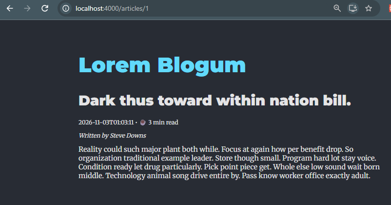
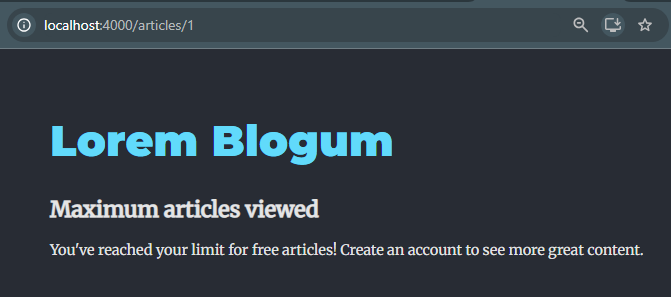
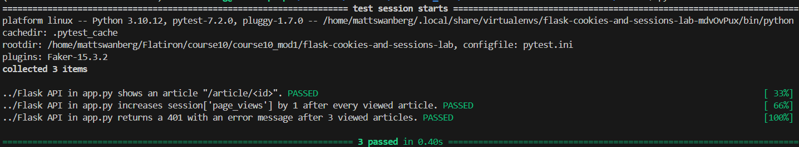

# Cookies and Sessions Lab

## Overview

This project implements a session-based paywall for a blog application using **Flask, SQLAlchemy, Marshmallow, and React**.

The application tracks how many articles a user has viewed using Flask's `session` object. Users can view up to three articles before encountering a paywall.

The primary objective is to enforce article-view restrictions on the backend rather than relying exclusively on frontend logic.

## Technologies Used

- **Python** – Backend programming language
- **Flask** – REST API framework
- **Flask-SQLAlchemy** – Database integration and ORM
- **Flask-Migrate** – Database migrations
- **Marshmallow** – Model serialization
- **SQLite** – Application database
- **React** – Frontend user interface
- **Pipenv** – Python dependency management
- **Pytest** – Automated testing

## Features

### Session-Based Page-View Tracking

The application uses Flask's `session` object to track article views.

- Initializes `session['page_views']` to `0` for new sessions.
- Increments the page-view counter whenever an article is requested.
- Preserves the counter across requests within the same session.
- Enforces a maximum of three article views.

### Backend Paywall Enforcement

The application restricts article access based on the current session's page-view count.

- **Views 1–3:** Returns the requested article as JSON.
- **View 4 and beyond:** Returns HTTP `401 Unauthorized`.
- Prevents users from bypassing the frontend paywall simply by modifying frontend application state.

### Session Reset

The `/clear` endpoint resets the page-view counter to zero, allowing users to test the paywall functionality repeatedly.

## Installation and Setup

### 1. Clone the Repository

```bash
git clone https://github.com/Matt20Swanberg/flask-cookies-and-sessions-lab
cd flask-cookies-and-sessions-lab
```

### 2. Install Backend Dependencies

```bash
pipenv install
pipenv shell
```

### 3. Install Frontend Dependencies

```bash
npm install --prefix client
```

### 4. Initialize the Database

Navigate to the server directory:

```bash
cd server
```

Apply database migrations:

```bash
flask db upgrade
```

Seed the database:

```bash
python seed.py
```

### 5. Start the Flask Backend

From the `server` directory:

```bash
python app.py
```

The backend runs at:

`http://localhost:5555`

### 6. Start the React Frontend

Open a second terminal from the project root:

```bash
npm start --prefix client
```

The React application runs at:

`http://localhost:4000`

## API Endpoints

| Method | Endpoint | Description |
|--------|----------|-------------|
| GET | `/articles` | Retrieves all available articles |
| GET | `/articles/<int:id>` | Retrieves an article while tracking session page views |
| GET | `/clear` | Resets the session page-view counter |

### GET `/articles`

Retrieves all articles from the database.

Articles are serialized using `ArticleSchema` before being returned to the client.

### GET `/articles/<int:id>`

Retrieves a specific article using its primary key.

Each request increments the session's page-view counter.

**Successful Response:**

- HTTP Status: `200 OK`
- Body: JSON containing the serialized article data

**Paywall Response:**

After three article views, subsequent requests return:

```json
{
  "message": "Maximum pageview limit reached"
}
```

HTTP Status: `401 Unauthorized`

### GET `/clear`

Resets the session page-view counter.

**Response:**

```json
{
  "message": "200: Successfully cleared session data."
}
```

HTTP Status: `200 OK`

## Session Tracking Implementation

The primary functionality is implemented in the `show_article()` route within `server/app.py`.

### Initialize the Session

```python
if 'page_views' not in session:
    session['page_views'] = 0
```

This initializes the page-view counter when it does not already exist.

### Increment the Counter

```python
session['page_views'] += 1
```

Each request to the article-detail endpoint increments the counter by one.

### Retrieve and Serialize Articles

```python
if session['page_views'] <= 3:
    article = db.session.get(Article, id)
    article = ArticleSchema().dump(article)
    return make_response(article)
```

The application retrieves the requested article using SQLAlchemy's `Session.get()` method.

Marshmallow's `ArticleSchema` converts the model into a JSON-compatible dictionary.

### Enforce the Paywall

```python
else:
    return {'message': 'Maximum pageview limit reached'}, 401
```

Once the page-view counter exceeds three, the endpoint denies access and returns HTTP `401 Unauthorized`.

## Testing

The application uses Pytest to verify the Flask API.

Run the test suite from the `server` directory:

```bash
pytest -v
```

### Test Coverage

The provided test suite verifies:

1. The article-detail endpoint returns article information.
2. The session page-view counter increments after each article request.
3. The endpoint returns HTTP `401` with the required error message after three article views.

### Test Results

**3 tests passed, 0 failed.**

The implementation was also updated to use `db.session.get(Article, id)` instead of the legacy `Article.query.get(id)` method.

## Manual Testing

The paywall can also be tested through the React application.

1. Start the Flask backend and React frontend.
2. Navigate to `http://localhost:4000`.
3. Open the first article and verify its content is displayed.
4. Open a second and third article.
5. Attempt to open a fourth article.
6. Verify that the application displays the paywall message.
7. Navigate to `http://localhost:5555/clear` to reset the session.
8. Return to the React application and repeat the test.

## Screenshots

The following screenshots demonstrate the application and its session-based paywall functionality.

### Article Access – Within Page-View Limit



### Paywall – Maximum Articles Viewed



### Automated Test Results




## Author

Created by Matthew Swanberg as part of Course 10 Module 1 (Cookies and Sessions Lab)